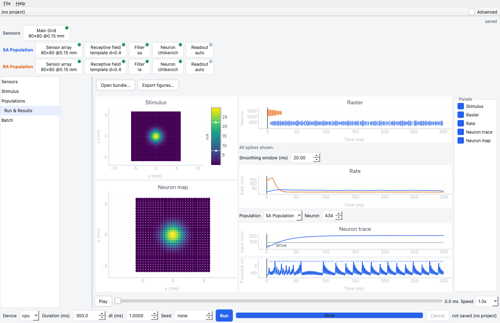

# SensoryForge

SensoryForge is a Python and PyTorch simulator of sensory encoding: a stimulus is sampled by a sensor array, passed through receptive fields, temporal filters and neuron models, and comes out as population activity. Touch is the first use, not the only one: it is built to extend to other modalities, and a new neuron, filter, stimulus, solver or grid is a small plugin package that needs no fork. Worlds and data sets generate stimuli at scale, and an evaluation pipeline audits them.

<p align="center">
  
</p>

## Install

Not yet on PyPI, so install from the git URL, with no clone ([all install options](https://benefron.github.io/sensoryforge/getting_started/installation/)). The same install runs SensoryForge and extends it; the tactile, world and evaluation workflow is one use of it.

```bash
python -m venv .venv && source .venv/bin/activate    # or a conda environment
pip install "git+https://github.com/benefron/sensoryforge.git"
sensoryforge list-components
# optional extras go in brackets (gui, hdf5, solvers, dsl); the GUI needs gui
pip install "sensoryforge[gui] @ git+https://github.com/benefron/sensoryforge.git"
# extend it: a standalone plugin, no fork (also: filter, stimulus, solver, grid)
sensoryforge new-component neuron MyNeuron
cd sensoryforge-my-neuron && pip install -e .        # installs your plugin, not SensoryForge
```

### Developing SensoryForge itself (a separate path)

Only to change SensoryForge's own code: fork it, and read [AGENTS.md](AGENTS.md) and [CONTRIBUTING.md](CONTRIBUTING.md) first.

```bash
git clone https://github.com/<you>/sensoryforge.git && cd sensoryforge
pip install -e ".[dev]"
pytest tests/unit -q
```

## Three ways to work

- **[CLI](https://benefron.github.io/sensoryforge/user_guide/cli/)**, for repeatable runs: `sensoryforge run --preset tactile_sa1_ra1 --duration 100`
- **[GUI](https://benefron.github.io/sensoryforge/user_guide/gui_walkthrough/)**, to design an experiment by eye: `python -m sensoryforge.gui.main`
- **[Agent](https://benefron.github.io/sensoryforge/agents/)**, in your own words: `sensoryforge agents install`, then `sensoryforge agents setup`

## Where to go next

- [Quick Start](https://benefron.github.io/sensoryforge/getting_started/quickstart/), [Core Concepts](https://benefron.github.io/sensoryforge/getting_started/concepts/), the [User Guide](https://benefron.github.io/sensoryforge/user_guide/overview/) and [all the docs](https://benefron.github.io/sensoryforge/) (sources in [`docs/`](docs/)).
- Extend it: [Plugin Packages](https://benefron.github.io/sensoryforge/developer_guide/plugins/) and [Extensibility](https://benefron.github.io/sensoryforge/developer_guide/extensibility/).
- Stimuli at scale: [Worlds and Data Sets](https://benefron.github.io/sensoryforge/user_guide/worlds/) and [Evaluating a World](https://benefron.github.io/sensoryforge/user_guide/evaluate_pipeline/).

## How this project is tracked

SensoryForge is tracked with the [living ledger](https://github.com/benefron/living-ledger): commit trailers become entries in [`docs_root/LEDGER.md`](docs_root/LEDGER.md). Two real ones, a finding and a decision (the install section above follows D-e05b02e):

```text
## F-5c66c69 · CLOSED · finding · - · 2026-10-23
evaluate/export/static/snapshot_shim.js was missing from the wheel
→ commit 5937de9

## D-0f3d007 · CLOSED · decision · - · 2026-11-02
the Rules for Agents page (six rules and the approval table) is approved as written
→ commit f787d90
```

MIT license ([LICENSE](LICENSE)). To cite SensoryForge, use [CITATION.cff](CITATION.cff). Bugs and questions: [GitHub issues](https://github.com/benefron/sensoryforge/issues).
